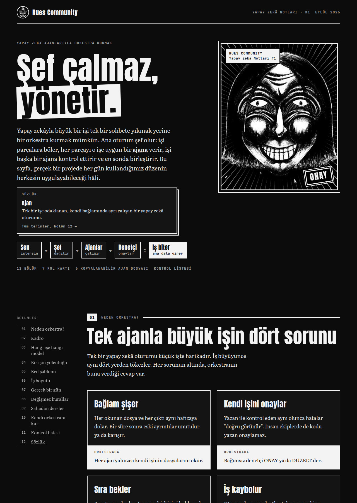
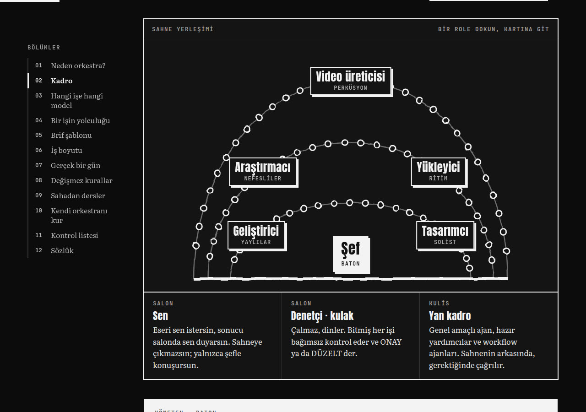

# Yapay Zekâ Orkestrası · RC AI Notları #1

[Telegram duyuru](https://t.me/RuesAnnouncement) · [Telegram](https://t.me/ruesandora) · [X @Ruesandora0](https://x.com/Ruesandora0)

Rues Community · Ekim 2026 · Son güncelleme: 26 Ekim 2026 · Gerçek bir projede her gün kullanılan düzenden derlendi.

---

> **Şef çalmaz, yönetir.** Büyük bir işi tek bir yapay zekâ sohbetine yıkmak yerine bir orkestra kur: ana oturum şef olur, işi uzman ajanlara böler, bağımsız bir denetçi kontrol eder, şef birleştirir.

**Canlı sayfa:** https://claude.ai/artifact/2aUHSAwuRb5pNgoTopiv4Q · **Dosya:** [`index.html`](index.html) — tek dosya, tarayıcıda doğrudan açılır. Açık ve koyu temayı destekler, telefonda da okunur.

## İçinde neler var

| Bölüm | Özet |
|---|---|
| Neden orkestra? | Tek ajanla büyük işin dört sorunu: bağlam şişer, kendi işini onaylar, sıra bekler, iş kaybolur |
| Kadro | Şef, yükleyici, araştırmacı, geliştirici, tasarımcı, video üreticisi, denetçi: her biri için model, neden o model, örnek işler, ne zaman kullanılmaz |
| Hangi işe hangi model | Haiku 5.5, Sonnet 5.5, Opus 5.5 için iki soruluk karar akışı (Haiku ve Sonnet'e artık daha çok iş); en zor işler için isteğe bağlı premium basamak Fable 5.1; `effort:` alanı; Bedrock/Vertex uyarısı |
| Bir işin yolculuğu | İstekten yayına 7 adım, en fazla 3 turluk DÜZELT döngüsü |
| Ajanın alt ajanı | Ajan kendi alt ajanını açar (en çok 4), alt ajan açamaz; model açıkça verilir; tek rapor; 3 katman sınırı ve `CLAUDE_CODE_MAX_SUBAGENT_SPAWN_DEPTH`; ayrı hesaplardaki ajanlar için depo üzerinden kanal (teslim dosyası, durum tablosu, şef notu) |
| Brif şablonu | GÖREV · SENİN DOSYALARIN · DOKUNMA · ÖNCE OKU · BAĞLAM · BİTTİ TANIMI · RAPOR |
| Gerçek bir gün | Aynı gün paralel çalışan denetim, tasarım ve workflow ajanları |
| Değişmez kurallar | On kural: para, ücretsiz limitin en çok %99'u, uydurma yok, mutasyon kontrolü, tehlikeli komutlar ve araç düzeyinde engel, konuşulan iş bırakılmaz (açık işler), kısa cevap ve doğrudan link |
| Sahadan dersler | Bitmeyen bekleme döngüsü, dolan disk, yeniden başlayan makine, denetçinin yakaladığı donma, yük altında düşen tarayıcı testleri, denetim bitmeden birleştirme… |
| Kendi orkestranı kur | Kopyalanabilir ajan dosyaları, kontrol listesi, sözlük |
| Başka araçta kullan | Codex ve AGENTS.md okuyan araçlar için kural, `.toml` ajan örnekleri, her yapay zekâya yapıştırılacak eşleme promptu |

## Hazır ajan dosyaları

[`ajanlar/`](ajanlar) klasöründeki dosyaları kendi projende `.claude/agents/` altına kopyala (Claude Code):

| Dosya | Model | Rol |
|---|---|---|
| [`denetci.md`](ajanlar/denetci.md) | Sonnet 5.5 (riskli işte Opus 5.5) | Başka ajanın işini bağımsız kontrol eder, ONAY / DÜZELT döner. İlk bunu kur. |
| [`gelistirici.md`](ajanlar/gelistirici.md) | Sonnet 5.5 | Tarif edilmiş kod değişiklikleri ve testler; alt ajan açabilir |
| [`arastirmaci.md`](ajanlar/arastirmaci.md) | Sonnet 5.5 | Kaynaklı araştırma; kod yazmaz; alt ajan açabilir |
| [`yukleyici.md`](ajanlar/yukleyici.md) | Haiku 5.5 | Mekanik toplu iş, basit okuma, özet, sınıflama, format |
| [`tasarimci.md`](ajanlar/tasarimci.md) | Opus 5.5 | Görsel tasarım yönü; alt ajan açabilir |
| [`video-ureticisi.md`](ajanlar/video-ureticisi.md) | Sonnet 5.5 | Video ve ses; ölçerek doğrular; alt ajan açabilir |
| [`derin-akil.md`](ajanlar/derin-akil.md) | Fable 5.1 (pahalı, nadir) | Çok adımlı belirsiz karar, çelişkili bulguların sentezi, zor hata ayıklama |

**Model görev tablosu:** Haiku 5.5 (en ucuz): mekanik iş + basit okuma, özet, sınıflama, format. Sonnet 5.5 (orta, varsayılan): kod, araştırma, normal denetim, metin. Opus 5.5 (yetenekli): görsel tasarım yönü, güvenlik/para/veri kaybı riski olan denetim. Fable 5.1 (premium, nadir): `derin-akil.md`; ölçüt: iş 2 DÜZELT turunda çözülmedi, çok adımlı ve belirsiz, çelişkili bulgular ya da zor hata, yanlış kararın bedeli yüksek. Bir işe ucuz modelin yetip yetmediğini kendi işinde ölçerek gör.

**`effort:`** Ajan dosyasının başlığına `effort:` yazılabilir: low, medium, high, xhigh, max (desteklenen değer modele göre değişir). Örneklerde yorum satırı olarak durur.

**Alt ajan:** Ajan kendi alt ajanını açabilir (`tools` listesinde `Agent` olmalı), alt ajan açamaz. İş başına en çok 4; her alt ajana model açıkça verilir; ajan sonuçları kendisi birleştirip şefe tek rapor verir. Claude Code belgesine göre ana konuşmanın altında en çok 3 katman açılır; `CLAUDE_CODE_MAX_SUBAGENT_SPAWN_DEPTH` derinliği ayarlar (1 = kapalı).

**Uyarı:** Bedrock ve Google Cloud'da `sonnet` takma adı Sonnet 4.5'e çözülür (Anthropic API'de Sonnet 5.5); Foundry'de `opus` Opus 4.6'ya. Bu araçlarda tam model kimliğini yaz.

Şefin kuralı için [`CLAUDE-orkestra-kurali.md`](ajanlar/CLAUDE-orkestra-kurali.md) içeriğini projendeki `CLAUDE.md` dosyasına ekle.

---

## Başka araçta kullan

[`diger-araclar/`](diger-araclar) klasörü: Codex ve `AGENTS.md` okuyan araçlar için [`AGENTS.md`](diger-araclar/AGENTS.md), [`codex-agents/*.toml`](diger-araclar/codex-agents) örnekleri (model alanı yer tutucu: kendi aracındaki model adını yaz) ve herhangi bir yapay zekâya yapıştırılacak [`yapistir-prompt.md`](diger-araclar/yapistir-prompt.md). Dosya yolu ve alan adlarını aracın güncel belgesinden doğrula.
